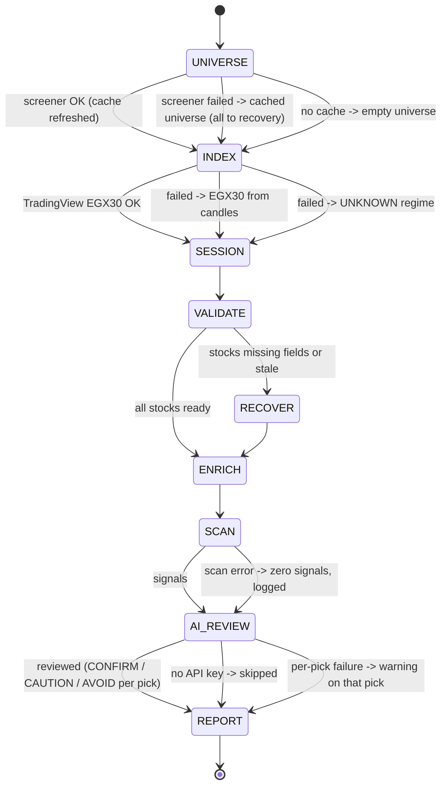
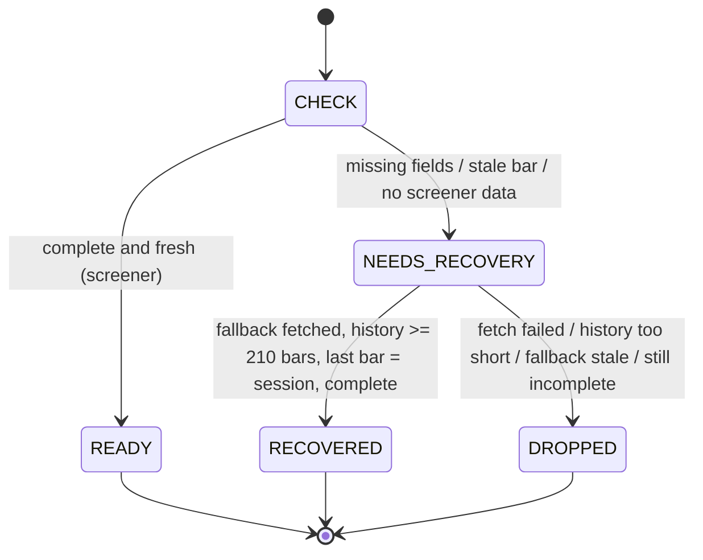

# EGX Swing Trader - Requirements

Status: living document. Each requirement has an ID so that code, tests and reviews can refer to it.
"Must" is mandatory, "should" is expected unless there is a documented reason.

## 1. Purpose and scope

The EGX Swing Trader scans the largest stocks on the Egyptian Exchange (EGX) after each session and suggests
long-only swing trades, meant to be held for about 2–10 sessions. Each suggestion comes with an entry, stop, targets
and a position size.

**In scope:** data collection, setup detection, trade planning, position sizing, a fundamentals and news review of
each pick (rule-based checks plus an AI review by Claude), a daily report, and scheduled automation.

**Out of scope:** placing or managing orders, short selling, intraday trading, using fundamentals or news to
*generate* picks (they can only demote or veto them), and portfolio tracking of trades that were actually taken.

The output is analytical only and is not financial advice. Every report must say so.

## 2. Users and usage

| User | Need |
|------|------|
| Trader | Reads the daily report after the close and decides which suggestions to act on in the next session. |
| Maintainer | Changes rules or thresholds, and needs tests that fail when a rule breaks. |
| Automation | GitHub Actions runs the scan Sunday to Thursday and commits the report. |

## 3. Functional requirements

### 3.1 Universe and data

| ID | Requirement |
|----|-------------|
| FR-1 | The universe must be the top N (default 100) primary EGX common stocks by market cap. |
| FR-2 | The primary source must be TradingView's Egypt screener on the daily timeframe. |
| FR-3 | The fallback source must be Yahoo Finance daily candles (`<TICKER>.CA`). Indicators are computed locally with TradingView's definitions (EMA seeded with an SMA, Wilder RSI/ATR/ADX, Stoch 14/3/3, MACD 12/26/9, BB 20/2, Perf.1M = close vs the last close before the same day one month earlier). |
| FR-4 | The **session date** must be the date (Cairo time) of the newest trade in the data, not the date the scan ran. |
| FR-5 | A stock's data must be **complete**: every field in `pipeline.REQUIRED` is a finite number. |
| FR-6 | A stock's data must be **fresh**: its last bar is on the session date. |
| FR-7 | Previous-bar Stoch must come from candle history, never from the screener's `Stoch.K[1]` / `Stoch.D[1]`, which were found to be inconsistent with its own %D. |
| FR-8 | Only EGP-quoted stocks are tradeable. USD-quoted listings must be excluded with a reason. |
| FR-9 | Stocks must be excluded when average daily value traded is below the floor (default 5M EGP), or when ATR is outside 1–8% of price. |

### 3.2 Setups (one per stock; priority PULLBACK > BREAKOUT > BOUNCE)

| ID | Setup | Conditions |
|----|-------|------------|
| FR-10 | PULLBACK | EMA20 > EMA50 > SMA200 and close > SMA200; low within 0.5 ATR of EMA20; close between EMA50 and EMA20 + 1 ATR; RSI 38–58; Stoch %K > %D, %K < 60, and %K rising when the previous bar is known. |
| FR-11 | BREAKOUT | close ≥ 99% of the 1-month high; volume ≥ 1.5× the 10-day average; ADX > 20 with +DI > −DI; RSI 55–78; close > EMA50. |
| FR-12 | BOUNCE | close > SMA200; RSI < 35, or RSI rising from below 30; low within 1% of the lower Bollinger band; RSI rising or Stoch %K > %D. |
| FR-13 | Every reason printed for a setup must describe the actual data, for example "crossed above today" versus "above and rising". |

### 3.3 Market regime (EGX30)

| ID | Requirement |
|----|-------------|
| FR-14 | RISK-ON when close > EMA20 > EMA50: risk × 1.0. |
| FR-15 | RISK-OFF when close < EMA50 and EMA20 < EMA50: risk × 0.5, and no breakouts. |
| FR-16 | NEUTRAL for anything else: risk × 0.75. |
| FR-17 | UNKNOWN when EGX30 data is unavailable: risk × 0.5, and no breakouts. |

### 3.4 Trade plan

| ID | Requirement |
|----|-------------|
| FR-18 | The entry is a buy-stop at high + 0.1 ATR. It must be at least one tick above the session high and is rounded **up** to the tick. |
| FR-19 | Ticks come from the stock's price scale: 0.01 EGP, or 0.001 under 1 EGP. Stops round **down**, and targets round to the nearest tick. |
| FR-20 | Stops: PULLBACK min(low, EMA50) − 0.5 ATR; BREAKOUT entry − 1.5 ATR; BOUNCE low − 0.75 ATR. |
| FR-21 | Targets: T1 = 1.5R and T2 = 3R. BOUNCE T1 = EMA20, kept between 1R and 1.5R. |
| FR-22 | Shares = (capital × risk% × regime multiplier) / R. The position is capped at 25% of capital and at 10% of average daily value traded. |
| FR-23 | Ranking = setup quality ± relative strength vs EGX30 (±10 beyond ±3 points) − 5 per warning. Sizing caps are notes and must not affect the ranking. |
| FR-24 | Warnings: resistance (1-month or 52-week high) between the entry and T1, and a 1-month gain above 25%. |

### 3.5 Fundamentals and news review

Picks come only from the technical setups (section 3.2). This layer can lower a pick's rank or remove it, but it can
never add a pick or raise its rank (FR-37).

| ID | Requirement |
|----|-------------|
| FR-30 | For every stock, fetch from the screener: P/E, P/B, EPS TTM, ROE, dividend yield, D/E, market cap, net income, revenue and the next earnings date. Missing values are shown as `n/a` and are never a filter. Recovered stocks keep the screener's fundamentals (EH-10 covers price data only). |
| FR-31 | Rule-based check: a loss-making company (negative EPS, ROE or net income) gets a warning (−5). |
| FR-32 | Rule-based check: an earnings release within 16 calendar days of the session (the holding window) gets a warning (−5). |
| FR-33 | AI review: each pick, up to `--ai-max` (default 8) in rank order, is sent to Claude (`claude-opus-5-5`, adaptive thinking, effort `high`) with the server-side web search tool (up to 5 searches per pick). Claude checks company news from the last 60 days, upcoming corporate actions, and the fundamentals. |
| FR-34 | The AI must return JSON matching `ai_review.REVIEW_SCHEMA` (structured outputs): verdict `CONFIRM`/`CAUTION`/`AVOID`, confidence, summary, news items (each with date, headline, source, URL and impact), upcoming events, a fundamentals view and risks. |
| FR-35 | `CONFIRM` leaves the pick unchanged. `CAUTION` adds a warning and −10 quality. `AVOID` moves the pick to a "Vetoed by AI review (do not trade)" section. |
| FR-36 | The report shows, under each pick, its fundamentals line and the AI verdict, with up to 5 linked headlines, upcoming events and risks. |
| FR-37 | The AI cannot add picks or raise quality. A wrong, hallucinated or manipulated answer can at worst cost a trade, never create one. |
| FR-38 | Offline replays (`--input`) and `--no-ai` runs never call the API. The fundamentals rules (FR-31, FR-32) still apply. |
| FR-39 | Server-side refusal fallback (`fallbacks: "default"`) is enabled. A refusal that remains after fallback counts as a failed review, not a verdict. |

### 3.5a Review skill (final answer in chat)

| ID | Requirement |
|----|-------------|
| SK-1 | The Claude Code skill `.claude/skills/egx-swing-review` triggers the workflow (with the `gh` CLI, or the GitHub MCP tools if `gh` is unavailable) using the user's capital and risk %, waits for it to complete, and reads `reports/latest.json`. If no trigger is possible, it runs the scanner locally with `--no-ai`. |
| SK-2 | It stops with "no trades" when `run_status` is FAILED, and warns when the run is DEGRADED, intraday, or from a stale session. |
| SK-3 | For each pick (at most 8) it researches 60 days of company news, corporate actions inside about 3 weeks, and fundamentals, citing a dated link for every headline. |
| SK-4 | Verdicts are TAKE / TAKE SMALLER (half shares) / SKIP, under the same only-demote rule as FR-37. It keeps the report's levels, never adds picks, never increases size, and keeps any vetoes from the workflow. |
| SK-5 | It answers in chat with the market line, a final table, per-pick evidence, total risk if all picks fill (flagged above 5% of capital) and the execution rules. |

### 3.5b Email

| ID | Requirement |
|----|-------------|
| EM-1 | After the report commit, the workflow emails the report (HTML plus a plain-text version, with `latest.md` attached) using `python -m egx_swing.notify`. |
| EM-2 | The email leads with plain buy instructions per pick (shares, buy price, money, stop, both sell prices), then totals for money used, the most you can lose, and the best case. Vetoed picks are listed as "don't buy". |
| EM-3 | SMTP credentials come only from repository secrets (`SMTP_USERNAME`, `SMTP_PASSWORD`). The recipient defaults to tare2fo2ad@gmail.com and can be overridden by a `MAIL_TO` secret. |
| EM-4 | With no credentials the step is skipped. A send failure is logged and never fails the job (EH-0). |

### 3.6 Outputs

| ID | Requirement |
|----|-------------|
| FR-25 | A markdown report containing: session date, run status, regime, a signals table (with R:R), per-stock reasons, warnings and notes, a **Data quality** section and how-to-use rules. |
| FR-26 | `--out-dir` writes `<session>.md`, `<session>.json`, `latest.md` and `latest.json`, all UTF-8. A run with no known session writes `<run-date>-FAILED.*` so it never overwrites a good report. |
| FR-27 | The JSON contains signals, exclusions, `data_status` per stock, `events` (the run log), `run_status`, `as_of` and `intraday`. |
| FR-28 | A run during an open session (before 14:45 Cairo on the session date) must be flagged `intraday`. |
| FR-29 | `--input` replays a saved snapshot offline and must refuse `--out-dir`. |

## 4. Error handling: always produce a report

**Hard requirement (EH-0): every run that starts must end with a report on disk and exit code 0.**
Data problems lower the run status. They never stop the run.

### 4.1 Run state machine

| ID | Stage | Primary | Fallback chain | On total failure |
|----|-------|---------|----------------|------------------|
| EH-1 | UNIVERSE | TradingView, 3 attempts with backoff (2s, 4s) | cached `data/universe.json` (written on every successful fetch) | empty universe, status FAILED |
| EH-2 | INDEX | TradingView EGX30, 3 attempts | EGX30 computed from Yahoo candles | regime UNKNOWN (FR-17) |
| EH-3 | SESSION | newest trade date in screener data | EGX30 bar date, then newest recovered bar | "unknown" session |
| EH-4 | VALIDATE | each stock checked against FR-5 and FR-6 | stocks that fail move to RECOVER | - |
| EH-5 | RECOVER | Yahoo candles, 2 attempts, computed with FR-3 | - | stock DROPPED, with the reason |
| EH-6 | ENRICH | previous-bar Stoch from candles for PULLBACK candidates | - | Stoch prev stays unknown; the "rising" check is skipped and the reason says "above %D" |
| EH-7 | SCAN | `setups.scan` | - | zero signals, error logged |
| EH-8 | CLI | the whole pipeline | - | emergency report, status FAILED, with the exception in the run log |
| EH-8a | AI_REVIEW | Claude review per pick; the SDK retries 2 times, and a paused search turn (`pause_turn`) is resumed up to 3 times | - | no key or SDK: SKIPPED (status unaffected). Per-pick error, refusal or invalid JSON: that pick keeps the warning "AI review unavailable - check news manually" and the others continue (PARTIAL). |
| EH-9 | Workflow | unit tests | a test failure is flagged in the job summary and never blocks the scan | the scan and commit steps run `if: always()` |

### 4.2 Per-stock state machine

| ID | Requirement |
|----|-------------|
| EH-10 | Data from the two sources must not be mixed for one stock. A recovered stock uses fallback indicators for every field, and keeps only its metadata (symbol, name, sector, currency, price scale) from the screener or cache. |
| EH-11 | A stock with no fresh data from any source must be dropped and listed in the report with the reason. Old data must never be used. |

### 4.3 Run status

| Status | Meaning |
|--------|---------|
| OK | All stages succeeded on primary data, and nothing was dropped. |
| DEGRADED | At least one fallback was used, or at least one stock was dropped. The report is still usable. |
| FAILED | No tradeable stocks, or an unexpected error. The report says **no trades**. |
| OFFLINE | Replay of a saved snapshot (`--input`). |

## 5. Non-functional requirements

| ID | Requirement |
|----|-------------|
| NFR-1 | Python 3.9+, standard library only. Must run without `tzdata` by falling back to built-in Egypt DST rules. |
| NFR-2 | A normal run should take under 60 seconds. A full-fallback run (screener down) of 100 stocks should take under 2 minutes, using 8 parallel requests. |
| NFR-3 | Network calls have timeouts (20–30 seconds) and bounded retries. Nothing may hang the workflow. |
| NFR-4 | Workflow inputs reach the shell only through environment variables, never through `${{ }}` inside `run:`. |
| NFR-5 | Unit tests must cover every setup condition, so that removing any one condition fails a test (checked by mutation runs), and every fallback path in sections 4.1 and 4.2. |
| NFR-6 | Reports are deterministic for the same input data, except for the AI review section. |
| NFR-7 | `ANTHROPIC_API_KEY` is passed only to the scan step as a repository secret, never to the unit tests. Tests use a fake client and must never call the API. |
| NFR-8 | AI cost is bounded: at most `--ai-max` picks × 5 web searches per run, and nothing on days with no picks. |
| NFR-9 | Search results are untrusted. The system prompt tells Claude to ignore instructions found in them, and FR-37 limits the impact of any that get through. |
| NFR-10 | The only third-party dependency is `anthropic` (`requirements.txt`). It is optional: without it the AI review is skipped. |

## 6. Schedule and automation

| ID | Requirement |
|----|-------------|
| AU-1 | Runs Sunday to Thursday at 13:00 UTC, which is after the 14:30 Cairo close in both summer and winter time. |
| AU-2 | Can be started by hand with capital and risk % inputs. |
| AU-3 | Commits `reports/` and `data/universe.json`. Checks out the branch tip and rebases before pushing, so that runs queued one after another don't conflict. |

## 7. Known limitations

- Yahoo has no usable EGX30 history, so when TradingView is down the regime is UNKNOWN. Risk is halved and breakouts
  are skipped.
- Fallback indicators can differ slightly from TradingView's. Measured on 8 large caps: about 0.1% for moving
  averages, about 0.2 points for RSI and about 2% for ADX and ATR. Yahoo can also have gaps in thinly traded names.
- Newly listed stocks with fewer than 210 sessions of history cannot be scored and are dropped.
- The rules have not been backtested, so the win rate is unknown.
- TradingView fundamentals are often partly missing for EGX names, for example P/E is null for loss-makers. The AI
  review may fill gaps from news sources, but its figures are not verified.
- News coverage of smaller EGX companies is thin. "No recent company-specific news" is common and is not a red flag
  by itself.
- AI verdicts are judgements and can be wrong. They are bounded by FR-37, but a CONFIRM is not a guarantee.
